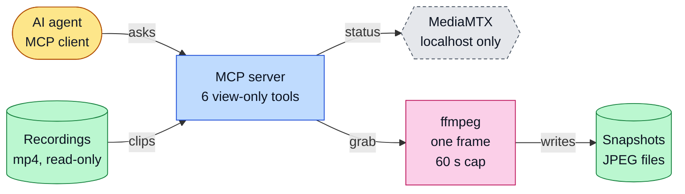
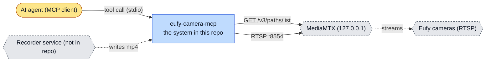
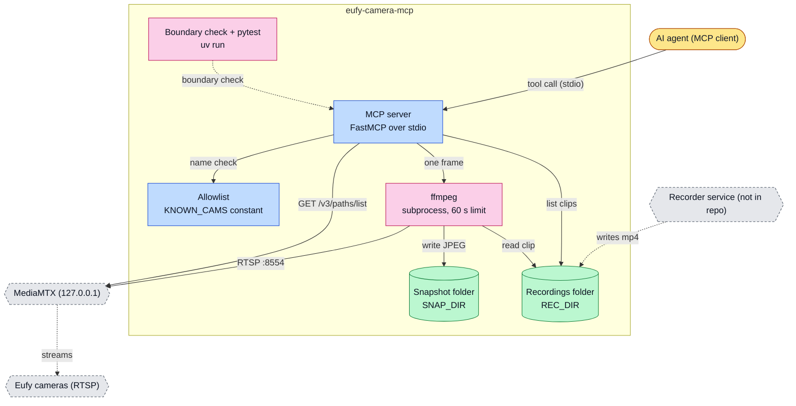
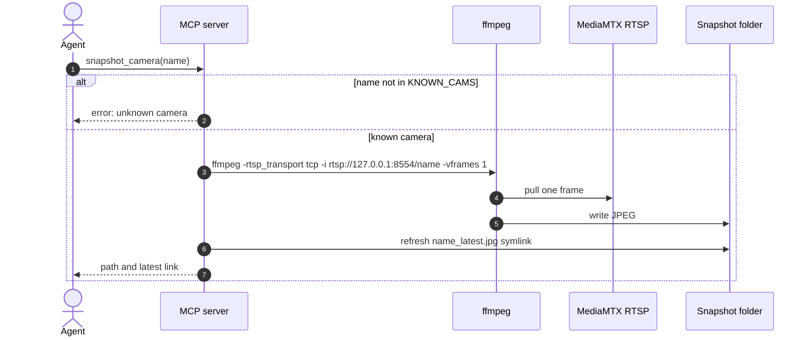
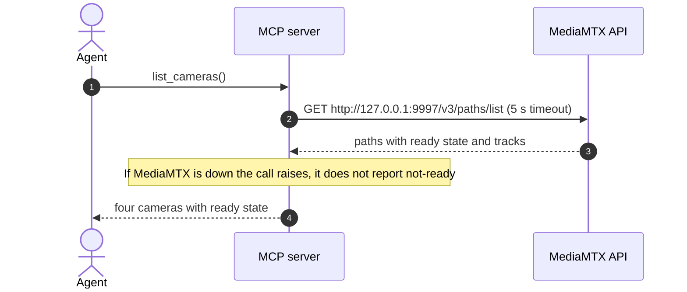
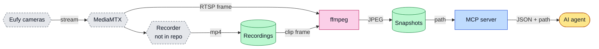
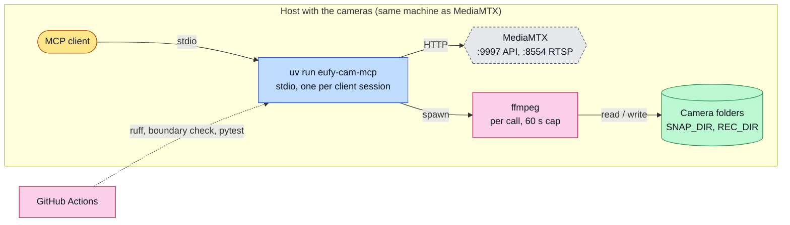

# eufy-camera-mcp: architecture

<!-- arch-kit:generated -->

> Whiteboard-level structure: what systems exist, what they talk to, and when they run. Evidence-backed; every box below maps to a path listed in [Evidence](#10-evidence).
> Generated by the ArchDocs kit from repo commit `7090c0e343`. Diagram sources: [`architecture/*.mmd`](architecture/). Hi-res renders sit next to each source.

## 1. Purpose

eufy-camera-mcp is a Python FastMCP server that gives an AI agent view-only access to four named local Eufy cameras. It reads live status from a MediaMTX instance on the same host, grabs one JPEG frame with `ffmpeg`, and lists or samples recorded motion clips from a folder. The point is a small attack surface: four allowlisted names, localhost MediaMTX only, one frame at a time, no pan/tilt, no talkback, no cloud API.

## 2. Whiteboard view

Six boxes. The agent can only ask; the server decides which of four cameras it may look at.

Hi-res: [SVG](architecture/whiteboard.svg) · [PNG 3x](architecture/whiteboard@3x.png) · [dark SVG](architecture/whiteboard.dark.svg) · [dark PNG 3x](architecture/whiteboard.dark@3x.png)

Explorable version (Archify, standalone HTML, download and open locally): [`architecture/eufy-camera-mcp.archify.html`](architecture/eufy-camera-mcp.archify.html)

## 3. System context (C4 level 1)

Who and what touches the system from outside.

Hi-res: [SVG](architecture/context.svg) · [PNG 3x](architecture/context@3x.png)

## 4. Containers and components (C4 level 2)

The parts that run or hold data inside the repo's system boundary.

Hi-res: [SVG](architecture/containers.svg) · [PNG 3x](architecture/containers@3x.png)

| Container | Kind | Tech | What it does | Evidence |
|---|---|---|---|---|
| MCP server | app | FastMCP over stdio | Registers six tools; rejects any camera name outside the allowlist before any I/O. | [`src/eufy_cam_mcp/server.py#L19-L19`](../src/eufy_cam_mcp/server.py#L19-L19), [`src/eufy_cam_mcp/server.py#L139-L140`](../src/eufy_cam_mcp/server.py#L139-L140) |
| Allowlist | app | KNOWN_CAMS constant | eufy_cam1 to eufy_cam4. Unknown or traversal names return an error. | [`src/eufy_cam_mcp/server.py#L17`](../src/eufy_cam_mcp/server.py#L17), [`src/eufy_cam_mcp/server.py#L44-L45`](../src/eufy_cam_mcp/server.py#L44-L45) |
| ffmpeg | job | subprocess, 60 s limit | One frame from RTSP or from a recorded clip. | [`src/eufy_cam_mcp/server.py#L67-L71`](../src/eufy_cam_mcp/server.py#L67-L71), [`src/eufy_cam_mcp/server.py#L130-L133`](../src/eufy_cam_mcp/server.py#L130-L133) |
| Snapshot folder | store | SNAP_DIR (default under the user's home) | JPEGs plus a <name>_latest.jpg symlink. Nothing prunes them. | [`src/eufy_cam_mcp/server.py#L15`](../src/eufy_cam_mcp/server.py#L15), [`src/eufy_cam_mcp/server.py#L66-L76`](../src/eufy_cam_mcp/server.py#L66-L76) |
| Recordings folder | store | REC_DIR (default under the user's home) | <name>_*.mp4 segments written by a separate recorder; read-only here. | [`src/eufy_cam_mcp/server.py#L16`](../src/eufy_cam_mcp/server.py#L16), [`src/eufy_cam_mcp/server.py#L94-L95`](../src/eufy_cam_mcp/server.py#L94-L95) |
| Boundary check + pytest | job | uv run | Proves bad names cause no MediaMTX call, no ffmpeg, no folder. | [`scripts/check-camera-boundaries.py`](../scripts/check-camera-boundaries.py), [`tests/test_server_tools.py`](../tests/test_server_tools.py) |

## 5. Key runtime sequences

### 5.1 snapshot_camera

An unknown name is rejected before any network call or process.

Hi-res: [SVG](architecture/sequence-1.svg) · [PNG 3x](architecture/sequence-1@3x.png)

### 5.2 list_cameras

Hi-res: [SVG](architecture/sequence-2.svg) · [PNG 3x](architecture/sequence-2@3x.png)

## 6. Data flow and stores

Video bytes never leave the host. Only file paths and small JSON come back to the agent.

Hi-res: [SVG](architecture/dataflow.svg) · [PNG 3x](architecture/dataflow@3x.png)

| Store | What it holds | Written by | Evidence |
|---|---|---|---|
| Snapshot folder | Timestamped JPEG frames and one latest symlink per camera. | snapshot_camera, clip_frame | [`src/eufy_cam_mcp/server.py#L15`](../src/eufy_cam_mcp/server.py#L15), [`src/eufy_cam_mcp/server.py#L66-L76`](../src/eufy_cam_mcp/server.py#L66-L76) |
| Recordings folder | Motion-clip mp4 segments named <camera>_*.mp4. | A separate recorder (not this repo) | [`src/eufy_cam_mcp/server.py#L16`](../src/eufy_cam_mcp/server.py#L16), [`README.md#L35`](../README.md#L35) |

## 7. Deployment and runtime topology

One stdio process started by the MCP client. It is not a hosted service.

Hi-res: [SVG](architecture/deployment.svg) · [PNG 3x](architecture/deployment@3x.png)

| What | Where | Runs when | Trigger / port | Evidence |
|---|---|---|---|---|
| MCP server | Host, stdio | While the MCP client session runs | client launches `uv --directory ... run eufy-cam-mcp` | [`README.md#L46-L57`](../README.md#L46-L57) |
| ffmpeg capture | Host | On each snapshot_camera or clip_frame call | tool call, 60 s timeout | [`src/eufy_cam_mcp/server.py#L67-L71`](../src/eufy_cam_mcp/server.py#L67-L71) |
| CI | GitHub Actions | Push and pull request to main | Ruff, boundary check, pytest | [`.github/workflows/ci.yml`](../.github/workflows/ci.yml) |

## 8. Failure modes and how to see them

| Failure | What the user sees | How to see it | Evidence |
|---|---|---|---|
| MediaMTX unreachable | list_cameras and camera_status raise instead of returning not-ready | Exception text from urlopen in the MCP client | [`src/eufy_cam_mcp/server.py#L22-L24`](../src/eufy_cam_mcp/server.py#L22-L24) |
| ffmpeg fails or times out (60 s) | Returns `ffmpeg capture failed`; timeout raises | error field in the tool result | [`src/eufy_cam_mcp/server.py#L67-L77`](../src/eufy_cam_mcp/server.py#L67-L77) |
| Camera name outside the allowlist | Error result, no process or network call | `unknown camera` in the result; boundary check script | [`src/eufy_cam_mcp/server.py#L44-L45`](../src/eufy_cam_mcp/server.py#L44-L45), [`scripts/check-camera-boundaries.py`](../scripts/check-camera-boundaries.py) |
| Snapshot folder grows without bound | Disk fills slowly; nothing prunes JPEGs | `du -sh` on the SNAP_DIR folder | [`README.md#L26`](../README.md#L26) |
| No recorder service running | recordings_info and motion_clips return empty | Segment count 0 in recordings_info | [`src/eufy_cam_mcp/server.py#L80-L91`](../src/eufy_cam_mcp/server.py#L80-L91) |

## 9. State machine

No state machine in this repo: the server keeps no long-lived state. Each tool call reads MediaMTX or the disk and returns.

## 10. Evidence

Every path below exists at the pinned commit; links are relative to `docs/`.

| Path | Why it matters |
|---|---|
| [`src/eufy_cam_mcp/server.py#L13-L19`](../src/eufy_cam_mcp/server.py#L13-L19) | Constants: MediaMTX URLs, folders, the four-name allowlist, the FastMCP app. |
| [`src/eufy_cam_mcp/server.py#L27-L136`](../src/eufy_cam_mcp/server.py#L27-L136) | The six tools and their boundary checks. |
| [`scripts/check-camera-boundaries.py`](../scripts/check-camera-boundaries.py) | Proves rejected names create no network call, process or folder. |
| [`tests/test_server_tools.py`](../tests/test_server_tools.py) | Nine pytest tests. |
| [`.github/workflows/ci.yml`](../.github/workflows/ci.yml) | Ruff, boundary check and tests on push and PR to main. |
| [`pyproject.toml`](../pyproject.toml) | Console script and Python >=3.12 requirement. |
| [`README.md`](../README.md) | Scope, configuration constants, known gaps. |

Collected mechanically by the kit ([`architecture/facts.json`](architecture/facts.json), not hand-edited):

- entry points: `eufy-cam-mcp`, `scripts`, `python-script-main`
- CI: `.github/workflows/ci.yml`

Graphify (local AST, no LLM) read this repo: 77 nodes, 125 edges, 12 communities. Most connected: `client_call()` (10), `asyncio_run()` (10), `eufy-camera-mcp` (10), `Repository Guidelines` (9), `clip_frame()` (8).

- Report: [`architecture/graphify/GRAPH_REPORT.md`](architecture/graphify/GRAPH_REPORT.md)
- Interactive graph: [`architecture/graphify/graph.html`](architecture/graphify/graph.html) (79 KB, download and open locally)
